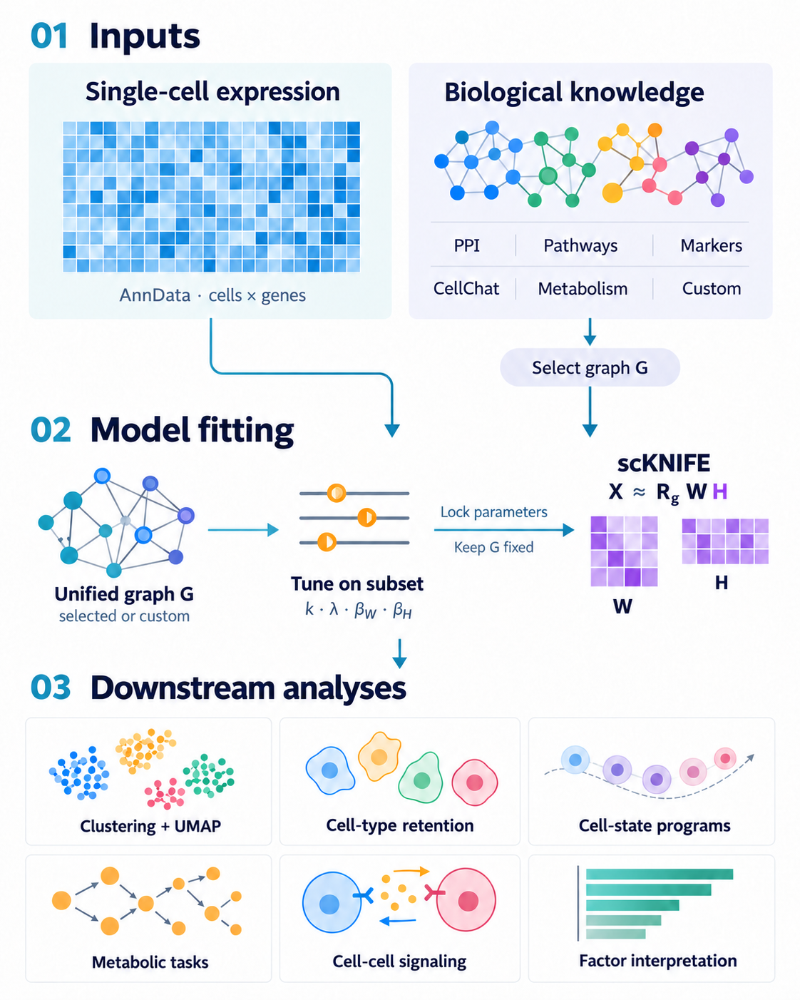

# scKNIFE

**Connect single-cell gene expression with biological knowledge to reveal interpretable cellular programs.**

[Documentation](https://scknife-docs.readthedocs.io/en/latest/) · [Tutorial notebook](tutorial/scKNIFE_Bassez_Cohort_B_complete_tutorial.ipynb) · [Installation](https://scknife-docs.readthedocs.io/en/latest/installation.html) · [Graph guide](https://scknife-docs.readthedocs.io/en/latest/graphs.html)

[](https://github.com/bernadettem03/scKNIFE/actions/workflows/tests.yml)
[](https://scknife-docs.readthedocs.io/en/latest/)
[](LICENSE)

scKNIFE uses graph-regularized non-negative matrix factorization to learn cell factors and biological-node loadings. Their reconstructed activity scores support metabolic analysis, factor interpretation and cell–cell signaling. The tutorial also examines how the learned representation retains known cell-type organization.

<p align="center">
  
</p>

## What you can explore

| Analysis | Biological question |
|---|---|
| [Cell-type retention](https://scknife-docs.readthedocs.io/en/latest/tutorials/10000-annotation.html) | Does the learned representation retain recognizable cell-type organization? |
| [Metabolic activity](https://scknife-docs.readthedocs.io/en/latest/tutorials/10000-metabolic.html) | How do metabolic-task activities and their linked reactions and genes vary across cells? |
| [Factor interpretation](https://scknife-docs.readthedocs.io/en/latest/tutorials/10000-factors.html) | Which biological entities characterize the learned factors and their consensus groups? |
| [Cell–cell signaling](https://scknife-docs.readthedocs.io/en/latest/tutorials/10000-signaling.html) | Which sender–receiver groups and ligand–receptor relationships have transcriptomic support? |

Activity scores are model-derived summaries. The main workflow uses source cell-type labels for interpretation and grouping; it does not assign new cell-type labels.

## Installation

Use a Python 3.9 environment; the tutorial environment was tested with Python 3.9.21.

```bash
git clone https://github.com/bernadettem03/scKNIFE.git
cd scKNIFE
python -m venv .venv
source .venv/bin/activate
python -m pip install -e '.[tutorial]'
```

See the [installation guide](https://scknife-docs.readthedocs.io/en/latest/installation.html) for environment details and the [API reference](https://scknife-docs.readthedocs.io/en/latest/api/index.html) for package functions.

## Run the 10,000-cell tutorial

The [complete notebook](tutorial/scKNIFE_Bassez_Cohort_B_complete_tutorial.ipynb) and [step-by-step tutorial](https://scknife-docs.readthedocs.io/en/latest/tutorial-10000.html) use a representative sample of 10,000 Bassez cohort-2 cells.

**Prepare inputs → tune on a representative subset → fit scKNIFE → examine cell-type retention → metabolism → factors → signaling.**

An optional [rank sensitivity and projection](https://scknife-docs.readthedocs.io/en/latest/tutorials/10000-validation.html) section demonstrates held-out projection within the same sample.

1. Follow [input preparation](https://scknife-docs.readthedocs.io/en/latest/tutorial-inputs.html) to obtain counts and metadata from the original source and prepare the directional interaction table.
2. Set the input paths as shown in the [quick start](https://scknife-docs.readthedocs.io/en/latest/quickstart.html).
3. Open the notebook in Jupyter, or execute it with:

```bash
python scripts/run_tutorial.py
```

The run saves the fitted model, activity scores, tables, figures and executed notebook in your configured output directory. Real cohort inputs are obtained separately. For the equivalent command-line stages, follow the [quick start](https://scknife-docs.readthedocs.io/en/latest/quickstart.html).

## Choose a graph

| Option | Use |
|---|---|
| **Ready-made Version 1 or Version 2** | Start with a unified biological graph. The tutorial uses Version 1; Version 2 adds Human-GEM. |
| **Seven individual collections** | Select Hallmark, CellChat, GO, markers, cell states, reactions or metabolic-task relationships. |
| **Custom graph** | Build a graph with the supplied APIs and upstream inputs appropriate to your question. |

Explore the [graph guide](https://scknife-docs.readthedocs.io/en/latest/graphs.html) and [supplied graph files](graphs/). Choose the graph before fitting. Analyses that require additional entities need a suitable graph and a new fit; downstream analyses can reuse the resulting activity scores.

## Citation and support

When using scKNIFE, cite the repository and the version or commit used, together with the biological resources included in your analysis. The manuscript citation will be added when available. See [citation guidance](https://scknife-docs.readthedocs.io/en/latest/citation.html) and [resource references](https://scknife-docs.readthedocs.io/en/latest/graph-resources.html).

For questions or reproducible problems, [open a GitHub issue](https://github.com/bernadettem03/scKNIFE/issues). Include your scKNIFE version, environment and a minimal example without private data.

## License

scKNIFE software and documentation use the [MIT License](LICENSE). Supplied biological resources retain their source-specific terms; see [resource references](https://scknife-docs.readthedocs.io/en/latest/graph-resources.html). These terms apply to both individual and unified graphs, and to upstream inputs used for custom graph construction.
