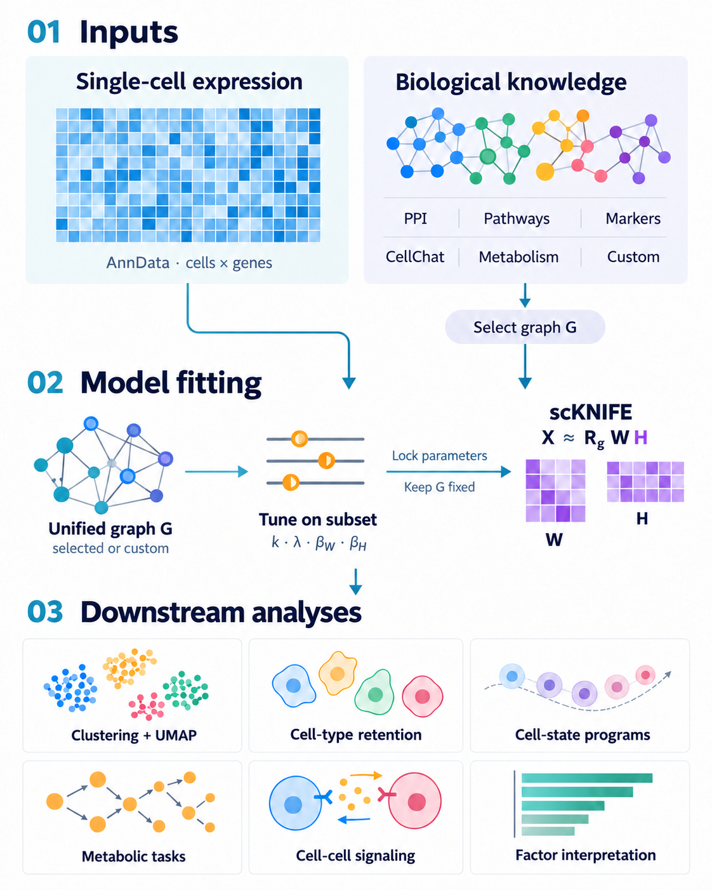

# scKNIFE

**Connect single-cell gene expression with biological knowledge to reveal interpretable cellular programs.**

[Documentation](https://scknife-tutorial.readthedocs.io/en/latest/) · [Tutorial notebook](tutorial/scKNIFE_Bassez_Cohort_B_complete_tutorial.ipynb) · [Installation](https://scknife-tutorial.readthedocs.io/en/latest/installation.html) · [Graph guide](https://scknife-tutorial.readthedocs.io/en/latest/graphs.html) · [Test runs](https://github.com/bernadettem03/scKNIFE/actions/workflows/tests.yml)

[](LICENSE)

scKNIFE uses graph-regularized non-negative matrix factorization to learn cell factors and biological-node activities.

<p align="center">
  
</p>

## Getting started

Use Python 3.9.21 and install the tutorial dependencies:

```bash
git clone https://github.com/bernadettem03/scKNIFE.git
cd scKNIFE
python -m venv .venv
source .venv/bin/activate
python -m pip install -e '.[tutorial]'
```

Place the [raw input files](https://scknife-tutorial.readthedocs.io/en/latest/tutorials/36721-setup.html#start-with-raw-counts) in `tutorial/inputs/`. Open the [36,721-cell notebook](tutorial/scKNIFE_Bassez_Cohort_B_complete_tutorial.ipynb) in Jupyter, or run all examples with:

```bash
python scripts/run_tutorial.py
```

The tutorial covers parameter tuning, fitting and [clustering](https://scknife-tutorial.readthedocs.io/en/latest/tutorials/36721-clustering.html). Each analysis below uses the saved fit.

## Analysis tasks

Choose any task using the saved fit and activities:

| Task | What you can do |
|---|---|
| [Factor interpretation](https://scknife-tutorial.readthedocs.io/en/latest/tutorials/36721-factors.html) | Group factors and explore their biological programs. |
| [Metabolic tasks](https://scknife-tutorial.readthedocs.io/en/latest/tutorials/36721-metabolic.html) | Explore MEAI on UMAPs, inspect a task and compare conditions. |
| [GO analysis](https://scknife-tutorial.readthedocs.io/en/latest/tutorials/36721-go.html) | Compare GO biological-process activities between conditions. |
| [Cell–cell signaling](https://scknife-tutorial.readthedocs.io/en/latest/tutorials/36721-signaling.html) | Explore sender–receiver scores, ligand–receptor pairs and pathways. |

See [more examples](https://scknife-tutorial.readthedocs.io/en/latest/#more-examples) for optional examples, including H projection, and the [API reference](https://scknife-tutorial.readthedocs.io/en/latest/api/index.html) for package functions.

## Choose a graph

| Option | Use |
|---|---|
| **Ready-made Version 1 or Version 2** | Start with a unified biological graph. The tutorial uses Version 1; Version 2 adds Human-GEM. |
| **Seven individual collections** | Select Hallmark, CellChat, GO, markers, cell states, reactions or metabolic-task relationships. |
| **Custom graph** | Build a graph with the supplied APIs and upstream inputs appropriate to your question. |

Explore the [graph guide](https://scknife-tutorial.readthedocs.io/en/latest/graphs.html) and [supplied graph files](graphs/). Choose the graph before fitting. Analyses that require additional entities need a suitable graph and a new fit; downstream analyses can reuse the resulting activity scores.

## Citation and support

When using scKNIFE, cite the repository and the version or commit used, together with the biological resources included in your analysis. The manuscript citation will be added when available. See [citation guidance](https://scknife-tutorial.readthedocs.io/en/latest/citation.html) and [resource references](https://scknife-tutorial.readthedocs.io/en/latest/graph-resources.html).

For questions or reproducible problems, [open a GitHub issue](https://github.com/bernadettem03/scKNIFE/issues). Include your scKNIFE version, environment and a minimal example without private data.

## License

scKNIFE software and documentation use the [MIT License](LICENSE). Supplied biological resources retain their source-specific terms; see [resource references](https://scknife-tutorial.readthedocs.io/en/latest/graph-resources.html). These terms apply to both individual and unified graphs, and to upstream inputs used for custom graph construction.
